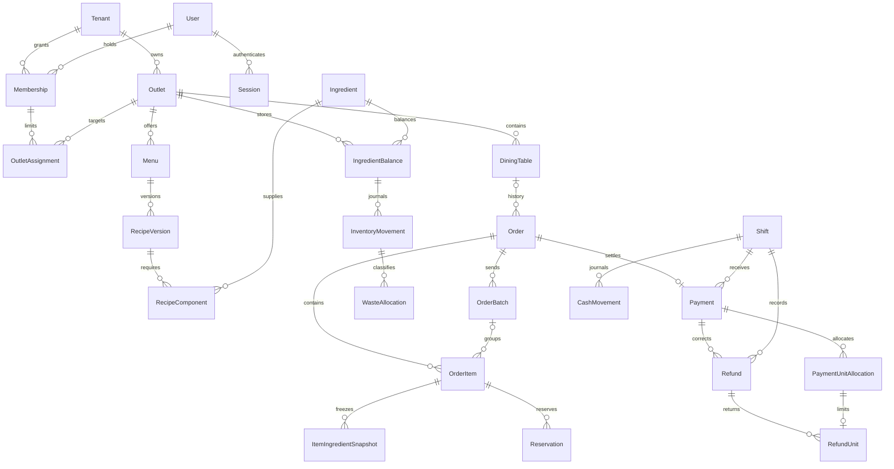

# Model data dan ERD awal

Status: rancangan, bukan schema Prisma/migrasi yang telah dijalankan. Perilaku mengacu [aturan bisnis](../product/business-rules.md) dan [settlement](../product/settlement-rules.md). Detail kondisional BR tetap menunggu keputusan; skema tidak boleh mengunci asumsi tersebut diam-diam.

## Konvensi tipe dan isolasi

- ID UUID dibuat server; waktu `timestamptz` dengan waktu UTC dan snapshot zona waktu outlet saat pelunasan/refund.
- Uang `bigint` nonnegatif dalam unit minor mata uang. Baseline kondisional IDR = rupiah; API berupa string digit, bukan JSON number. Batas bigint dan perkalian divalidasi; perhitungan menengah desimal/rational eksak.
- Kuantitas bahan usulan `numeric(20,6)`, API string desimal maksimal 6 digit pecahan. Konversi rasional eksak; hasil tak terwakili ditolak, bukan dibulatkan diam-diam. Rate usulan `numeric(9,6)` dalam persen 0..100; API string desimal. Kuantitas menu integer positif.
- Setiap tabel outlet-scoped menyimpan `tenant_id`, `outlet_id`, `id`; UNIQUE `(tenant_id,outlet_id,id)` dan FK komposit ke induk yang sama. Tenant-scoped memakai `(tenant_id,id)`. Kolom scope wajib NOT NULL; jangan hanya mengandalkan UUID global.
- Master dinonaktifkan, tidak dihapus jika sudah dirujuk riwayat. FKs sumber transaksi memakai RESTRICT; audit/ledger/refund historis tidak dihapus lewat cascade.
- Kolom `version` integer meningkat pada agregat mutable. Snapshot transaksi immutable sesudah titik kunci; correction berupa entri baru.

## ERD domain utama

ERD menggambarkan relasi domain; scope FK komposit tetap berlaku walaupun tidak ditampilkan di diagram.

## Kamus entitas

| Entitas | Field/data penting | Invariant |
| --- | --- | --- |
| Tenant, Outlet | Nama, status; outlet currency, timezone, pricing config version | Tenant terpisah; konfigurasi divalidasi dan historinya tidak ditimpa pada transaksi |
| User, Session | Login identifier, password hash; token hash, expiry, revoked_at | Token mentah tidak tersimpan/log; user nonaktif tidak beroperasi |
| Membership, OutletAssignment | User, tenant, role, status; outlet assignment | Unique user/tenant; assignment mereferensikan tenant yang sama; perubahan izin diaudit |
| Category, Menu, Variant | Nama, active, harga dan versi | Harga eksak; semua referensi scope valid |
| ModifierGroup, ModifierOption, MenuModifierGroup | Batas pilihan, pilihan/harga, menu yang boleh memilih | Min/max valid, option bagian group; snapshot menyimpan pilihan aktual |
| Unit, Ingredient, UnitConversion | Dimensi, satuan dasar, faktor rasional | Faktor positif, dimensi sama; unit conversion bukan tabel antarberat/volume bebas |
| RecipeVersion, RecipeComponent | Menu/variant atau modifier option, version, ingredient, base_qty | CHECK tepat satu jenis pemilik; FK pemilik scope sama; satu versi aktif per pemilik; komponen positif; versi lama immutable dan lengkap sebelum kirim |
| IngredientBalance | Ingredient, on_hand, reserved | Unique scope/ingredient; CHECK `on_hand >= reserved AND reserved >= 0` |
| InventoryMovement | Ingredient, delta_on_hand, delta_reserved, event kind, source, actor, reason | Source event+ingredient unik; ledger dan saldo ditulis atomik; konsumsi delta keduanya negatif |
| Reservation | Item, ingredient, reserved_qty, consumed_qty, released_qty | Unique item/ingredient; konsumsi+pelepasan <= kuantitas awal; saldo reservasi cocok ledger |
| WasteAllocation | Consumption movement atau waste movement, qty, reason, source | Klasifikasi tidak mengurangi saldo lagi; akumulasi <= konsumsi asal, tidak mengklasifikasi ulang unit yang sama |
| DiningTable, Order | Nomor meja; mode, table_id?, status, version | Dine-in wajib meja; takeaway tanpa meja; partial unique meja untuk DRAFT/OPEN |
| OrderBatch, OrderItem | Order, batch sequence; original qty, refunded/cancelled qty, preparation status, version | Unique order/batch sequence; item draft batch null; qty aktif tidak negatif; state BR-02/03 |
| ItemIngredientSnapshot, ItemModifierSnapshot | Resep/versi, base qty per unit; label/harga opsi | Snapshot dibuat saat kirim, immutable; kapasitas dihitung dari snapshot dan kuantitas aktif |
| OrderPricingSnapshot | Config version, currency, timezone, gross/discount/service/tax/total | Satu snapshot settlement per order; jumlah komponen eksak; item price dikunci saat kirim |
| Payment | Order, shift, method, total, received/change, operation_id, paid_at | Unique scope/order; total positif; digital received=total/change=0; tunai received-change=total |
| PaymentUnitAllocation | Payment, item, unit ordinal, gross/discount/net/service/tax/refund entitlement | Unique payment/item/ordinal; jumlah alokasi sama total; unit ordinal stabil |
| Refund, RefundUnit | Payment, active actor shift, method, reason, reference; allocated unit, disposition | RefundUnit unique allocation ID; tidak ada refund unit dua kali; method sama payment; amount dari alokasi |
| Shift | Actor, OPEN/CLOSED, opening/expected/actual/difference, version | Partial unique actor/outlet WHERE OPEN; actual >=0; closed snapshot immutable |
| CashMovement | Shift, source type/id, direction, amount, reason | Amount positif, source unik; sumber pembayaran memakai total setelah kembalian; digital tidak membuat entry kas |
| Operation | Scope, actor, idempotency key, command, request hash, response/status, resource | Unique scope/actor/key; satu key tidak boleh dipakai command/payload berbeda; hasil sukses tersimpan bersama mutasi |
| AuditEntry | Actor, scope, request/operation ID, action, subject, reason, safe before/after | Append-only oleh service; tidak ada secret; read dibatasi |

Kitchen queue adalah query item/batch, bukan database kedua. Receipt/laporan adalah proyeksi snapshot pembayaran, refund dan ledger. Payment state dihitung atau diperbarui di bawah lock dari payment/refund; jangan menyimpan salinan state yang tidak direkonsiliasi.

## Constraint dan batas transaksi

Partial unique diperlukan untuk meja dan shift aktif. Bila migrator Prisma yang dipilih tidak menyatakan constraint ini secara native, gunakan migrasi SQL terkontrol. Referensi order/payment/shift/refund dihubungkan lewat FK komposit scope. Operasi stok awal terhadap ingredient balance yang belum ada memakai insert-on-conflict lalu lock row; jangan lock row yang belum ada dan mengira sudah terlindungi.

CHECK hanya untuk invariant satu row. Total refund/alokasi, konsistensi snapshot, waste kumulatif, serta saldo ledger memerlukan validasi application service dalam transaksi dengan row lock; tidak dijanjikan melalui CHECK lintas tabel. Gunakan unique allocation untuk mencegah dua refund atas unit sama.

Indeks awal: scope+status+created_at+id pada order/queue, scope+paid_at+id pada payment, scope+refunded_at+id pada refund, scope+ingredient+created_at pada ledger; scope+actor pada shift dan assignment. Ukur query plan sebelum menambah indeks untuk semua field.

## Review dan migrasi

Uji FK lintas tenant/outlet, partial unique, batas numeric/bigint, insert saldo bersamaan, dan rollback sebelum schema dinyatakan siap. Gunakan migrasi maju, staging, backup dan latihan restore; jangan menyebut rollback data telah aman tanpa uji. O-006 tetap rancangan sampai schema nyata diuji; O-001–05, tarif outlet dan presisi bahan perlu diselesaikan sebelum kontrak schema final.
