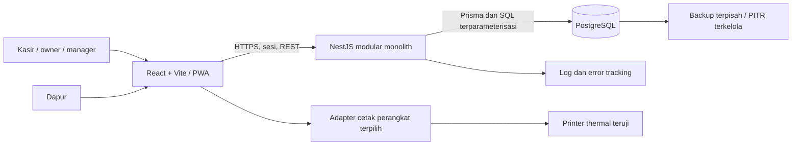

# Arsitektur Servio POS

Status: rancangan baseline dokumentasi, belum berupa aplikasi. Memetakan ARCH-01–04 pada backlog. Pilihan BR yang belum disetujui tetap bersifat kondisional; merge dokumen tidak mengubahnya menjadi konfigurasi outlet final.

## Konteks dan container

Frontend menyimpan draft, bukan sumber saldo atau pembayaran. Printer bukan bagian transaksi database. QRIS/EDC adalah pencatatan manual, tanpa koneksi payment gateway. Koneksi database hanya dari backend, tidak dari browser.

Usulan deployment: satu origin HTTPS untuk aset web dan `/api/v1`, proxy ke backend; PostgreSQL pada jaringan privat. Development memakai proxy Vite agar perilaku cookie tetap sejalan. Runtime/versi dependency dikunci saat scaffold, bukan diasumsikan sudah terpasang.

## Batas modul

| Modul | Memiliki | Batas interaksi |
| --- | --- | --- |
| Identity & Access | User, sesi, membership, outlet assignment | Menyediakan konteks aktor/tenant/outlet dan keputusan izin |
| Catalog | Menu, varian, modifier, resep dan versi | Menyediakan snapshot tervalidasi; tidak mengubah transaksi historis |
| Inventory | Saldo, reservasi, ledger, waste | Melayani reservasi/konsumsi/pelepasan dalam transaksi pemanggil |
| Orders | Pesanan, item, batch, meja | Orkestrasi pengiriman, konflik versi, penutupan dan pembatalan |
| Kitchen | Proyeksi antrean dan perintah status item | Melalui orkestrasi Orders; tidak mengonsumsi stok secara terpisah |
| Settlement | Pelunasan, alokasi per unit, refund | Mengunci order dan berkoordinasi Inventory/Shift secara atomik |
| Shifts | Shift, kas, hitungan tutup | Menerima mutasi dari pembayaran/refund pada transaksi yang sama |
| Reporting & Audit | Proyeksi laporan, audit append-only | Baca sumber tersimpan; tidak memperbaiki angka dengan mutasi tersembunyi |

Gunakan application service untuk satu command lintas modul dan satu konteks transaksi. Modul tidak memulai transaksi mandiri di tengah transaksi pemanggil. Tidak ada HTTP internal antarmodul atau microservice pada pilot.

## Alur kritis

1. **Kirim batch:** autentikasi/izin → idempotency → lock order dan saldo → validasi versi/katalog → snapshot, item/batch, reservasi, audit, hasil operasi → commit.
2. **Mulai persiapan:** lock order/item/saldo → verifikasi QUEUED dan kuantitas tersisa → konsumsi reservasi dan ledger → PREPARING → commit.
3. **Pelunasan:** lock shift dan order → verifikasi total/versi/shift aktif → simpan pembayaran dan alokasi refund → kas/audit/status/hasil operasi → commit. Tidak mengonsumsi bahan lagi.
4. **Refund:** lock shift, order, payment, unit dan saldo terkait → verifikasi hak/status → refund, pelepasan reservasi bila belum disiapkan, kas/audit/status → commit. Tidak memanggil layanan uang eksternal dalam transaksi.
5. **Cetak:** baca struk tersimpan setelah commit; kegagalan menawarkan cetak ulang dengan transaksi yang sama.

## Sesi, tenant, dan frontend

Cookie sesi opaque `HttpOnly`, `Secure` pada HTTPS, `SameSite=Lax`, path `/`; hash token disimpan server. Login merotasi token; logout mencabut sesi. TTL idle/absolut dikonfigurasi dan diuji saat fitur akses dibuat. Lindungi mutasi dengan CSRF token serta pemeriksaan Origin; rate-limit login. Jangan simpan token sesi di localStorage.

Tenant/outlet pada URL hanyalah selector; server memeriksa membership serta assignment pada setiap request. Owner dibatasi tenant sendiri. Membership/sesi terkunci selama command kritis sehingga pencabutan dan operasi bisnis memiliki urutan yang jelas, sesuai [ADR transaksi](adr/002-transactions-and-recovery.md).

TanStack Query mengelola data server; keranjang state lokal terpisah. Penyimpanan draft memakai namespace pengguna/tenant/outlet, bukan cache respons sensitif global. Logout menghapus draft/cache lokal milik sesi sesuai UX yang akan dikunci; service worker hanya menyimpan aset statis, bukan API, sesi, struk, atau laporan.

## Antrean dapur dan operasional

Pilot memakai polling snapshot REST saat layar aktif, usulan interval 3 detik dengan backoff pada kegagalan; reconnect selalu mengambil snapshot terbaru. Command status tetap tervalidasi server. Ini tidak menjanjikan realtime subdetik dan tidak memerlukan Redis/WebSocket. Jika kebutuhan berubah, buat ADR baru.

Ekspor CSV dibatasi ukuran/rentang dan otorisasi; di atas batas respons sinkron ditolak dengan instruksi mempersempit filter. Ambang ditetapkan lewat pengukuran pilot. Background worker/outbox baru ditambahkan bila ada integrasi yang memerlukan pengiriman andal, bukan sebagai syarat checkout awal.

Database managed dengan backup terpisah/PITR menjadi target operasional. RPO/RTO, retensi, hosting dan anggaran masih terbuka. Migrasi versi di source control; staging dan restore terpisah sebelum pilot. Log memakai request ID dan operation ID, tanpa cookie/password/token. Readiness memeriksa DB; liveness hanya proses.

## Dokumen turunan

- [Model data dan ERD](data-model.md)
- [ADR struktur dan keamanan](adr/001-modular-monolith.md)
- [ADR transaksi dan pemulihan](adr/002-transactions-and-recovery.md)
- [Kontrak REST awal](../api/README.md)
- [Strategi pengujian](../engineering/testing.md)

Referensi desain: [PostgreSQL locking](https://www.postgresql.org/docs/current/explicit-locking.html), [constraints](https://www.postgresql.org/docs/current/ddl-constraints.html), [Prisma transactions](https://www.prisma.io/docs/orm/prisma-client/queries/transactions), dan [OWASP sessions](https://cheatsheetseries.owasp.org/cheatsheets/Session_Management_Cheat_Sheet.html). Ini referensi kemampuan teknologi, bukan bukti implementasi telah lolos uji.
